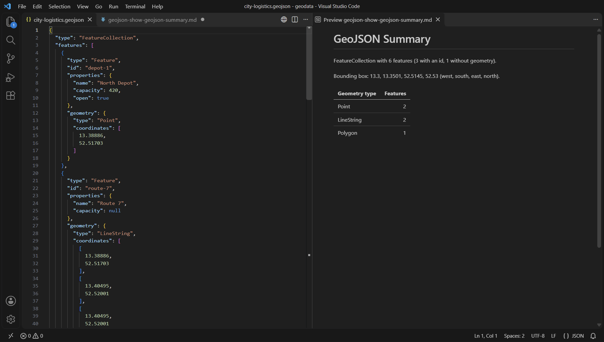
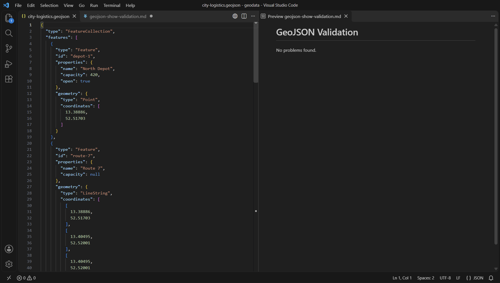
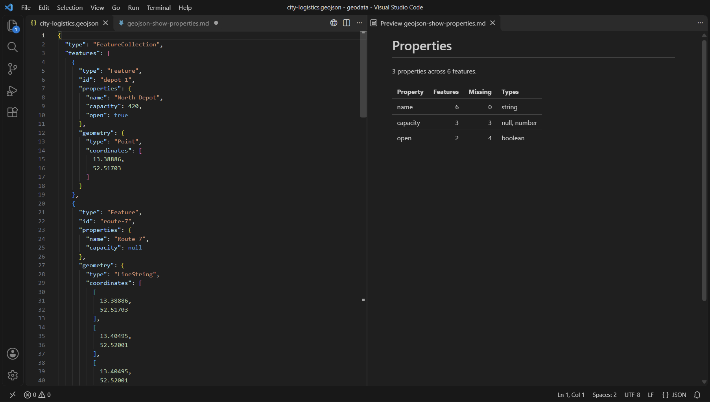
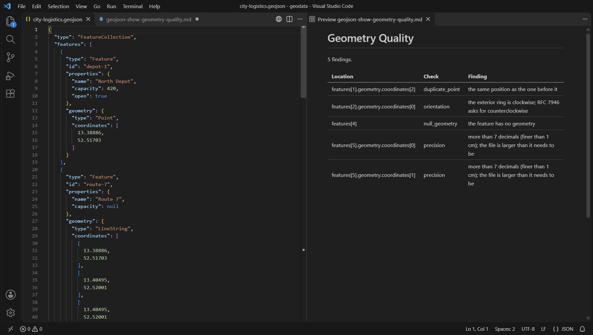
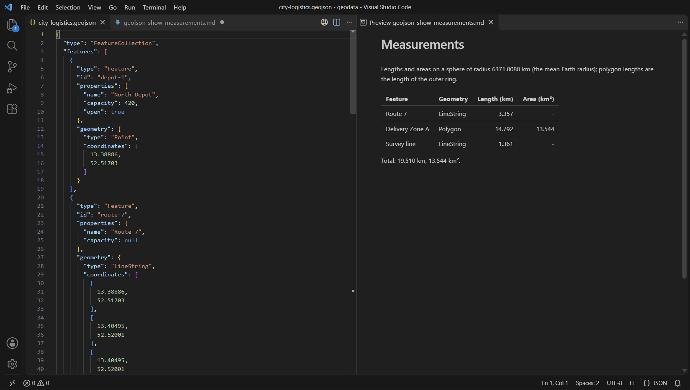

# GeoJSON Atlas

GeoJSON Atlas reads GeoJSON files and turns them into clear Markdown reports: the features, geometry types and bounding box, every RFC 7946 problem with its location (including longitude and latitude that look swapped), the properties and their types, geometry quality problems such as clockwise rings, duplicate points and excess precision, and the length and area of every line and polygon.

Everything runs on your computer. There is no telemetry. The only network request the extension ever makes is the licence check for the optional Pro tier (see [Privacy](PRIVACY.md)).

## What it does

* **Show GeoJSON Summary**: The file at a glance: features, ids, features without geometry, bounding box and geometry types.
* **Show Validation**: RFC 7946 problems with their location: structure, positions, coordinate ranges, swapped coordinates and unclosed rings.
* **Show Properties**: Every property key with the number of features that have it and the value types found.
* **Show Geometry Quality** (Pro): Clockwise rings, duplicate points, excess precision, empty geometries and bounding boxes that do not fit.
* **Show Measurements** (Pro): The length and area of every line and polygon, with totals.

## Free, trial and Pro

| Feature | Free | Pro |
| --- | :---: | :---: |
| Show GeoJSON Summary | yes | yes |
| Show Validation | yes | yes |
| Show Properties | yes | yes |
| Show Geometry Quality |  | yes |
| Show Measurements |  | yes |
| Open Sample File, walkthrough, Report A Problem | yes | yes |

The free reports need no key, no account and no network connection, and they will not be moved behind the licence key later. The first Pro command starts a **free 14-day trial** on this computer. After that, Pro is a one-time purchase, not a subscription: **Pro Personal USD 19** (one person, use at work allowed) or **Pro Business USD 39 per user** (one key per user of an organisation). A key works on up to 3 computers. The checkout page shows the final price and any taxes for your country. Licence keys are sold by Dodo Payments, the merchant of record. Details: [licence](docs/licence.md), [terms](TERMS.md).

## Commands

Open the Command Palette and type `GeoJSON Atlas`.

| Command | Tier |
| --- | :---: |
| GeoJSON Atlas: Show GeoJSON Summary | Free |
| GeoJSON Atlas: Show Validation | Free |
| GeoJSON Atlas: Show Properties | Free |
| GeoJSON Atlas: Show Geometry Quality | Pro |
| GeoJSON Atlas: Show Measurements | Pro |
| GeoJSON Atlas: Open Sample File | Free |
| GeoJSON Atlas: Open Walkthrough | Free |
| GeoJSON Atlas: Show Documentation | Free |
| GeoJSON Atlas: Report A Problem | Free |
| GeoJSON Atlas: Buy Pro | Free |
| GeoJSON Atlas: Enter Licence Key | Free |
| GeoJSON Atlas: Show Licence Status | Free |
| GeoJSON Atlas: Remove Licence From This Machine | Free |

## Settings

| Setting | Default | Meaning |
| --- | --- | --- |
| `geojsonAtlas.maxFileSizeMB` | 50 | Largest file a report reads (0.1 to 50 MB; VS Code passes files only up to 50 MB to extensions). |
| `geojsonAtlas.openReportsAsPreview` | true | Open each report in the Markdown preview as well. |

## FAQ

**Does GeoJSON Atlas upload my data?**
No. Every report is created on your computer from the text in the editor, and nothing is sent anywhere.

**How does it notice swapped coordinates?**
When a latitude is outside -90 to 90 while the pair would be valid the other way round, the validation report says that longitude and latitude look swapped. Pairs that are valid both ways cannot be told apart and are not reported.

**How accurate are the lengths and areas?**
They are computed on a sphere with the mean Earth radius (6371.0088 km), which is within about half a percent of ellipsoidal results for most places; holes are subtracted from polygon areas.

**Does it draw a map?**
No. It lists, checks and measures the data as text reports; use a map viewer to see the shapes.

## For IT and procurement

* Publisher: SmallStepsStudio (Visual Studio Marketplace), smallstepsstudio (Open VSX).
* Network: one host, `live.dodopayments.com`, for the licence check only, and only after a key is entered. No telemetry. The trial uses no network.
* Files are read from the editor only; the extension writes no files and changes none.
* Source: <https://github.com/small-steps-studio/geojson-atlas>.
* Licence agreement: [LICENSE.txt](LICENSE.txt). Terms: [TERMS.md](TERMS.md). Privacy: [PRIVACY.md](PRIVACY.md).

## Support

Run **GeoJSON Atlas: Report A Problem** or open an issue at <https://github.com/small-steps-studio/geojson-atlas/issues>. Never post a licence key or confidential data in a public issue.

GeoJSON is defined in RFC 7946 of the IETF; GeoJSON Atlas is an independent product and is not affiliated with or endorsed by the IETF.
